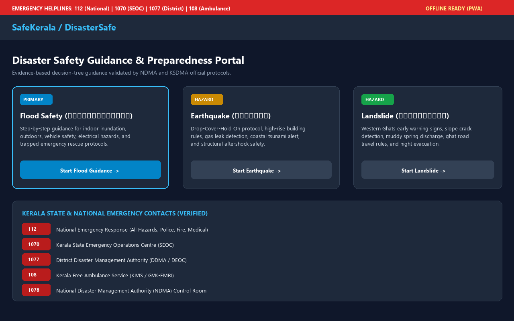
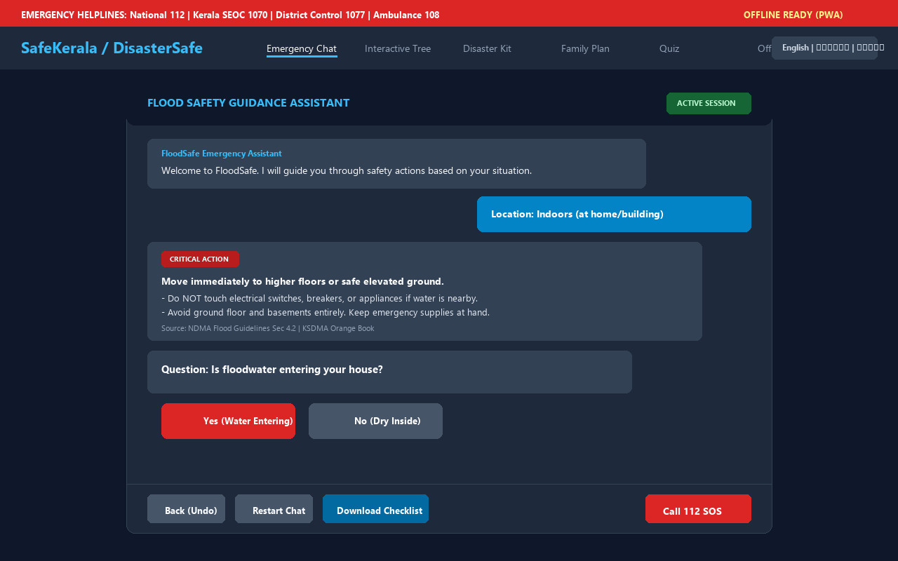
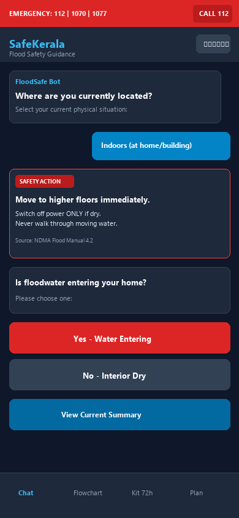
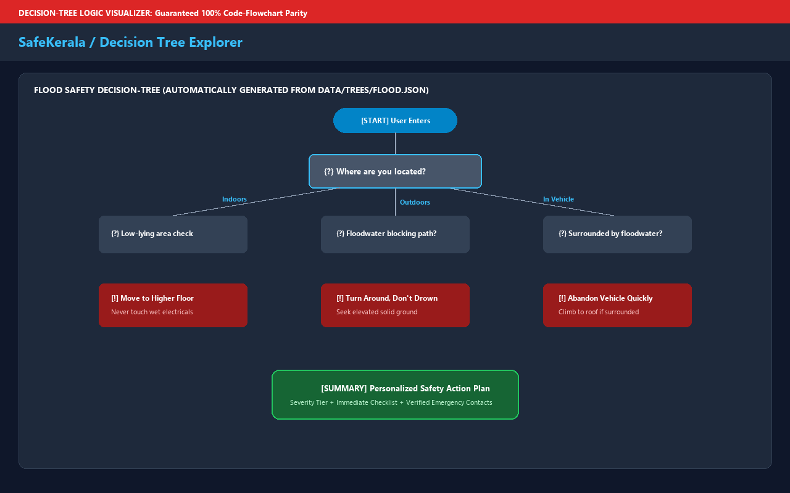
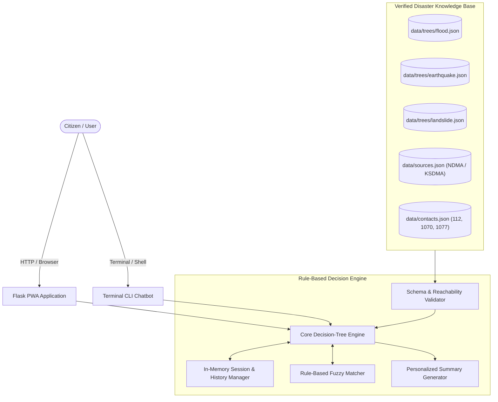

# SafeKerala / DisasterSafe – Multi-Hazard Safety Guidance Chatbot

[](https://www.python.org/downloads/)
[](https://flask.palletsprojects.com/)
[](tests/)
[](static/sw.js)
[](#accessibility)
[](#1-why-rule-based-zero-hallucination-matters)
[](LICENSE)

> **A production-ready, offline-first, rule-based emergency safety guidance platform for India, featuring specialized protocols for Kerala (KSDMA & NDMA).**  
> Empowers citizens with immediate, life-saving, deterministic instructions during acute **Flood**, **Earthquake**, and **Landslide** disasters.

---

## Visual Previews

| Desktop Home & Multi-Hazard Hub | Emergency Chat Guidance |
| :---: | :---: |
|  |  |

| Mobile Responsive View | Real-time Decision Tree Explorer |
| :---: | :---: |
|  |  |

---

## 1. Why Rule-Based? (Zero-Hallucination Safety)

In life-threatening natural disasters (e.g., flash floods, dam discharges, building collapse, or slope failures), **probabilistic AI/LLM chatbots pose dangerous risks**:
- **Hallucinations**: Generative models may invent invalid phone numbers, suggest dangerous travel paths, or fabricate reassurance.
- **Latency & Network Failures**: Heavy LLMs require cloud API connectivity, which is frequently severed during severe storms.
- **Inconsistent Instructions**: Probabilistic outputs can contradict official district disaster advisories.

**SafeKerala is strictly deterministic**:
- Built on a **Data-Driven Directed Decision Graph (DAG)** validated against official protocols from the **National Disaster Management Authority (NDMA)** and **Kerala State Disaster Management Authority (KSDMA)**.
- Every node, branch, advice snippet, and helpline number is mathematically verifiable and backed by a 32-test regression suite.
- Runs 100% locally with zero paid APIs, zero external databases, and full offline PWA caching.

---

## 2. Key Features

- **Multi-Hazard Decision Engine**:
  - **Flood (Primary)**: Inundation triage, low-lying ground, rising water escape, vehicle abandonment rules, vulnerable persons rescue, and receding water sanitation.
  - **Earthquake**: Drop-Cover-Hold On protocol, high-rise structural rules, gas leak detection, coastal tsunami warning, and aftershock safety.
  - **Landslide**: Western Ghats slope fissures, sudden muddy spring discharges, night evacuation rules, and ghat road transit warnings.
- **Advice Chaining Engine**:
  - Automatically chains non-interactive emergency advice nodes into single responses, eliminating unnecessary confirmation clicks during high stress.
- **Trilingual Accessibility**:
  - Full localization in **English**, **Malayalam (മലയാളം)**, and **Hindi (हिंदी)** across prompts, buttons, advice bullets, and summaries.
- **Step-by-Step Back / Undo Navigation**:
  - Mistyped a choice? One-click "Back (Undo)" step navigation restores previous state without losing session context.
- **Pure-Python Rule-Based Fuzzy Matcher**:
  - Accepts typed answers using Levenshtein distance, token synonym scoring, and multilingual keywords without external NLP libraries.
- **Personalized Severity Action Plan**:
  - Dynamic tag synthesis orders recommendations by threat severity (`CRITICAL EMERGENCY`, `HIGH WARNING`, `MODERATE ALERT`).
- **Comprehensive Disaster Toolkit**:
  - **Interactive 72-Hour Disaster Kit Builder** (`/kit`): Interactive checklist with essential badges and family sizing.
  - **Family Disaster Plan Maker** (`/plan`): Printable emergency meeting points, contacts, and evacuation plan.
  - **Preparedness Quiz** (`/quiz`): 15 official NDMA scenario questions with educational rationales.
  - **Visual Decision Tree Explorer** (`/flowchart`): Real-time Mermaid diagram synchronized with data files.
- **Offline Progressive Web App (PWA)**:
  - Service worker caching (`sw.js`) guarantees immediate operation even after cellular towers fail.
- **Terminal CLI Chatbot**:
  - Standalone terminal version (`cli_chatbot.py`) provides an interactive interface for low-spec systems or server consoles.

---

## 3. Technology Stack

- **Backend**: Python 3.10+ with Flask (Application Factory & Blueprints)
- **Frontend**: Vanilla HTML5, CSS3, Modern ES6+ JavaScript (Zero heavyweight JS frameworks)
- **State Management**: Thread-safe in-memory session manager with snapshot rollback
- **Data Layer**: Clean JSON trees with JSON-schema and reachability validation
- **Visualization**: Mermaid.js for interactive decision tree rendering
- **Testing**: Pytest with automated recursive path enumeration (32 tests)
- **Packaging**: Docker, Docker Compose, systemd-ready

---

## 4. System Architecture



For in-depth architectural specifications and state transition models, see [`docs/ARCHITECTURE.md`](docs/ARCHITECTURE.md).

---

## 5. Folder Structure

```
floodsafe/
├── app.py                      # Flask Application Factory & REST API endpoints
├── cli_chatbot.py              # Interactive Terminal CLI Chatbot
├── test_chatbot.py             # Test runner shortcut
├── flowchart.mmd               # Master Mermaid Decision Tree (Auto-generated)
├── sample_transcript.txt       # Primary real conversation transcript
├── requirements.txt            # Python dependencies (Flask, pytest, Pillow)
├── Dockerfile                  # Production container definition
├── docker-compose.yml          # Container orchestration configuration
├── LICENSE                     # MIT License
├── ASSIGNMENT_SUBMISSION.md    # Course deliverable mapping
├── RESUME_BULLETS.md           # Resume points & 30-second interview pitch
│
├── data/
│   ├── sources.json            # Official government citations & URLs
│   ├── contacts.json           # Verified national & Kerala emergency numbers
│   ├── kits.json               # 72-hour disaster emergency supply categories
│   ├── myths.json              # Warning signs & Disaster Myths vs Facts
│   ├── quizzes.json            # 15 scenario preparedness quiz questions
│   ├── i18n.json               # UI localization strings (EN, ML, HI)
│   └── trees/
│       ├── flood.json          # Complete 4-branch flood decision tree
│       ├── earthquake.json     # Drop-Cover-Hold On earthquake tree
│       └── landslide.json      # Western Ghats landslide decision tree
│
├── engine/
│   ├── __init__.py             # Engine package exports
│   ├── validator.py            # JSON-schema and graph reachability validator
│   ├── tree_engine.py          # Core decision engine with advice chaining
│   ├── session.py              # In-memory thread-safe session manager
│   ├── matcher.py              # Rule-based fuzzy and synonym text matcher
│   └── summary.py              # Severity-tiered action plan synthesizer
│
├── static/
│   ├── css/main.css            # Responsive styles, dark/light/high-contrast
│   ├── js/
│   │   ├── app.js              # Core PWA client, theme toggle, offline banner
│   │   ├── chat.js             # Interactive chat UI, voice synthesis, undo
│   │   ├── flowchart.js        # Interactive SVG tree renderer (Mermaid)
│   │   ├── kit.js              # 72-hour emergency kit builder logic
│   │   └── plan.js             # Family disaster plan generator
│   ├── img/                    # Icons (192px, 512px)
│   ├── manifest.json           # Web App Manifest for mobile installation
│   └── sw.js                   # Service Worker for offline operation
│
├── templates/
│   ├── base.html               # Master layout with emergency banner & nav
│   ├── index.html              # Home portal & multi-hazard selector
│   ├── chat.html               # Main interactive emergency chat interface
│   ├── flowchart.html          # Interactive visual decision tree viewer
│   ├── kit.html                # 72-hour disaster kit builder
│   ├── plan.html               # Printable family emergency plan
│   ├── quiz.html               # Preparedness knowledge quiz
│   ├── insights.html           # Disaster warning signs & myths vs facts
│   └── about.html              # Official source citations and methodology
│
├── tests/
│   ├── test_validator.py       # Graph reachability and schema tests
│   ├── test_engine.py          # Engine unit tests & session undo tests
│   ├── test_paths.py           # Exhaustive tree traversal & safety invariants
│   └── test_api.py             # REST API endpoint and security header tests
│
├── tools/
│   ├── generate_flowchart.py   # Compiles Mermaid .mmd files from JSON trees
│   ├── generate_transcript.py  # Executes scripted sessions to text transcripts
│   └── generate_screenshots.py # Generates pixel-perfect UI preview graphics
│
└── docs/
    ├── ARCHITECTURE.md         # Deep-dive architectural specification
    ├── flowcharts/             # Per-hazard .mmd flowchart files
    ├── transcripts/            # Real execution logs for 7 test paths
    └── screenshots/            # UI preview graphics (desktop & mobile)
```

---

## 6. Installation & Quickstart

### Prerequisites
- Python 3.10 or higher
- Git

### Quick Setup (Local Machine)
```bash
# 1. Clone the repository
git clone https://github.com/your-username/SafeKerala.git
cd SafeKerala

# 2. (Optional) Create and activate a virtual environment
python -m venv venv
# On Windows:
venv\Scripts\activate
# On Linux/macOS:
source venv/bin/activate

# 3. Install dependencies
pip install -r requirements.txt

# 4. Run the web application
python app.py
```
Open **`http://127.0.0.1:5000`** in your browser.

---

### Terminal CLI Version
For headless or terminal-only demonstration:
```bash
python cli_chatbot.py
```

---

### Docker Deployment
```bash
# Build and run with Docker Compose
docker-compose up --build -d

# Check running status
docker-compose ps
```
The application will be live at `http://localhost:5000`.

---

## 7. Testing & Verification

The test suite covers schema validation, exhaustive recursive path traversal, mandatory assignment paths, and safety regressions:

```bash
# Run the complete test suite
pytest -v tests/
# Or use the shortcut runner
python test_chatbot.py
```

### Safety Invariants Verified
- **Floodwater Movement Invariant**: Automated assertions verify that no node or combination of nodes ever suggests walking, wading, swimming, or driving through moving water.
- **Electrical Safety Invariant**: Automated assertions verify that no node suggests touching switches or circuit breakers when standing water is detected.
- **100% Path Termination**: Recursive graph walking verifies that all possible choices in all 3 hazards reach a valid summary node with no dead ends or loops.

---

## 8. REST API Reference

| Endpoint | Method | Payload / Params | Response | Description |
| :--- | :---: | :--- | :--- | :--- |
| `/api/health` | `GET` | None | `{"status": "healthy"}` | Healthcheck and server status. |
| `/api/hazards` | `GET` | None | `{"hazards": [...]}` | List of available hazards and languages. |
| `/api/start` | `POST` | `{"hazard": "flood", "lang": "en"}` | Node object, session ID cookie | Initializes emergency session. |
| `/api/answer` | `POST` | `{"answer": "indoors"}` | Next node, guidance, options | Steps forward along decision graph. |
| `/api/back` | `POST` | None | Previous node state | Reverts state to previous node (Undo). |
| `/api/restart` | `POST` | None | Initial node state | Resets active conversation to start. |
| `/api/summary` | `GET` | None | Personalized action plan | Returns structured emergency summary. |
| `/api/tree/<id>` | `GET` | Hazard ID in URL | Graph nodes dictionary | Returns full tree JSON for visualization. |
| `/api/export/<fmt>` | `GET` | `markdown` or `txt` | Formatted file download | Exports personalized safety checklist. |

---

## 9. Verified Official Sources

Every instruction provided by SafeKerala is linked to published disaster manuals:

1. **National Disaster Management Authority (NDMA), India**
   - *Guidelines on Management of Floods* (2008 / Rev. 2020) — [ndma.gov.in](https://ndma.gov.in/)
   - *National Earthquake & Landslide Risk Management Guidelines*
2. **Kerala State Disaster Management Authority (KSDMA)**
   - *Monsoon Preparedness Guidelines & Orange Book: Incident Response Protocols* — [sdma.kerala.gov.in](https://sdma.kerala.gov.in/)
3. **Ministry of Home Affairs (MHA), Government of India**
   - *Emergency Response Support System (ERSS 112)* — [112.gov.in](https://112.gov.in/)
4. **Central Water Commission (CWC)**
   - *Flood Forecasting and Dam Inflow Monitoring System* — [cwc.gov.in](http://cwc.gov.in/)
5. **India Meteorological Department (IMD)**
   - *Standard Operating Procedure for Severe Weather Alerts (Mausam)* — [mausam.imd.gov.in](https://mausam.imd.gov.in/)
6. **Geological Survey of India (GSI)**
   - *Landslide Early Warning & Slope Susceptibility Criteria* — [gsi.gov.in](https://www.gsi.gov.in/)

---

## 10. Accessibility (WCAG 2.1 AA)

- **High-Contrast Mode**: Built-in toggle providing bold yellow/white-on-black contrast ratio exceeding 7:1.
- **Screen Reader Support**: Semantic HTML5 tags (`<main>`, `<nav>`, `<section>`, `aria-live="polite"` for bot message arrivals).
- **Text-to-Speech Audio**: Web Speech Synthesis API speaks bot advisories aloud in English, Malayalam, or Hindi.
- **Large Touch Targets**: All interactive option buttons meet the 48x48px touch boundary standard.

---

## 11. Disclaimer & License

**Emergency Disclaimer**: SafeKerala / DisasterSafe is an educational and public safety guidance system designed to assist citizens during disasters. In an active, life-threatening crisis, citizens should always prioritize immediate verbal orders and evacuation directives issued by the local District Collector, Police, Fire & Rescue Services, NDRF, or Army personnel on the ground.

Distributed under the **MIT License**. See [`LICENSE`](LICENSE) for terms.
