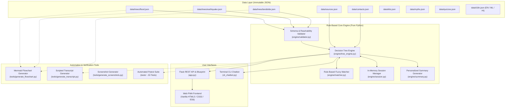

# SafeKerala / DisasterSafe – System Architecture

## 1. Overview & Architectural Philosophy

**SafeKerala / DisasterSafe** is an offline-capable, rule-based multi-hazard disaster guidance system engineered for India, with specialized disaster management protocols for Kerala (KSDMA & NDMA).

The core architectural tenet of SafeKerala is **Zero-Hallucination Determinism**: in acute life-threatening emergencies (such as flash floods, severe earthquakes, or landslides), safety advisories cannot be entrusted to probabilistic LLMs which may invent helpline numbers, hallucinate hazardous escape routes, or provide contradictory advice. Instead, SafeKerala uses an immutable, mathematically validated **Data-Driven Directed Decision Graph (DAG)** where:
1. Every state transition is deterministic and schema-validated.
2. Every guidance action is mapped to an official government authority citation (NDMA, KSDMA, CWC, IMD, GSI).
3. Critical safety invariants (e.g. "Never drive through moving water", "Never switch electricals while wet") are guaranteed by automated regression test suites.

---

## 2. Component Architecture



---

## 3. Core Engine Components

### 3.1 Decision Tree Engine (`engine/tree_engine.py`)
- Loads hazard trees on startup and registers them in an in-memory dictionary.
- Executes state transitions upon user option selection or typed input.
- Handles **Advice Chaining**: When a node points to an intermediate `advice` node, the engine automatically traverses subsequent advice nodes in sequence, collecting their guidance bullets and source references, until reaching the next interactive question or terminal summary node. This delivers immediate actionable advice without halting the dialogue.
- Enforces multi-language localization (`en`, `ml`, `hi`) dynamically per request.

### 3.2 Schema & Graph Validator (`engine/validator.py`)
Guarantees graph integrity before any tree is mounted:
- **No Orphan Nodes**: All nodes must be reachable from `initial_node_id`.
- **No Dead Ends**: Every non-summary node must have valid outbound transitions.
- **Node Typing**: Strict validation of `question`, `advice`, `emergency_check`, and `summary` node formats.
- **Source Verification**: Every `advice` node must specify a `source_id` matching a verified record in `data/sources.json`.
- **Translation Completeness**: Asserts that prompt text, options, and guidance bullets are present in all supported languages (`en`, `ml`, `hi`).

### 3.3 Rule-Based Fuzzy Matcher (`engine/matcher.py`)
Allows users to type free text instead of clicking buttons, without requiring external NLP services:
1. Exact option ID match.
2. Normalized substring matching across English, Malayalam, and Hindi.
3. Levenshtein edit distance matching (threshold $\le 2$ edits).
4. Domain token synonym matching (e.g. mapping "car", "van", "bus", "driving", "വാഹനം", "गाड़ी" $\to$ `"vehicle"`).
5. Affirmative/Negative token scoring for yes/no triage questions.

### 3.4 In-Memory Session Manager (`engine/session.py`)
- Thread-safe session tracking keyed by UUIDv4 session identifiers.
- Maintains snapshot history of path states enabling an instant **Back / Undo** feature.
- Accumulates context tags along the user's path (`indoors`, `water_ingress`, `electrical_hazard`, `trapped`, `slope_fissures`).
- Zero disk-write overhead for user conversations, ensuring high privacy and zero database requirement.

### 3.5 Personalized Summary Generator (`engine/summary.py`)
When a conversation terminates at a `summary` node, the generator synthesizes a structured action plan:
- **Risk Level Evaluation**: Evaluates accumulated tags to assign `CRITICAL EMERGENCY`, `HIGH WARNING`, or `MODERATE ALERT`.
- **Immediate Life-Safety Checklist**: Prioritized list of immediate actions (evacuation, higher ground, calling 112).
- **Preparation & Stabilization Steps**: Secondary actions (monitoring CWC/IMD broadcasts, document waterproofing).
- **Communication Directives**: Instructions on SMS battery conservation and distress signalling.
- **Relevant Emergency Numbers**: Curated phone numbers based on hazard and situation.

---

## 4. REST API Specification

| Endpoint | Method | Description |
| :--- | :--- | :--- |
| `/api/health` | `GET` | Health check and engine status. |
| `/api/hazards` | `GET` | Returns list of configured hazards, languages, and metadata. |
| `/api/start` | `POST` | Initializes a new session for a given hazard and language. |
| `/api/answer` | `POST` | Processes user selection or free-text input and returns next state. |
| `/api/back` | `POST` | Steps back one node in conversation history (undo action). |
| `/api/restart` | `POST` | Resets current session back to hazard initial state. |
| `/api/summary` | `GET` | Retrieves full summary checklist for completed session. |
| `/api/tree/<hazard_id>` | `GET` | Exports full JSON node graph for interactive tree visualization. |
| `/api/export/<format>` | `GET` | Exports emergency action plan as formatted `markdown` or `txt`. |
| `/api/triage` | `POST` | Instant quick triage based on immediate danger checkboxes. |
| `/api/feedback` | `POST` | Collects anonymous feedback for disaster preparedness rating. |

---

## 5. Extensibility Guide: How to Add a New Hazard

Adding a new disaster hazard (e.g., **Cyclone** or **Chemical Spill**) requires **zero Python code modifications**:

1. **Create Tree JSON File**:
   Add `data/trees/cyclone.json` with the standard schema:
   ```json
   {
     "hazard_id": "cyclone",
     "name": { "en": "Cyclone", "ml": "ചുഴലിക്കാറ്റ്", "hi": "चक्रवात" },
     "description": { "en": "Tropical cyclone safety and surge guidance" },
     "initial_node_id": "cy_q1_location",
     "nodes": {
       "cy_q1_location": {
         "id": "cy_q1_location",
         "type": "question",
         "text": { "en": "Where are you currently sheltering?" },
         "options": [
           { "id": "pucca_house", "text": { "en": "Pucca (Concrete) Building" }, "next_node": "cy_pucca_check" },
           { "id": "kutcha_house", "text": { "en": "Kutcha / Tin / Asbestos roof house" }, "next_node": "cy_evacuate_cyclone" }
         ]
       },
       "cy_evacuate_cyclone": {
         "id": "cy_evacuate_cyclone",
         "type": "advice",
         "severity": "critical",
         "source_id": "ndma_cyclone_guidelines",
         "guidance": [
           { "en": "Move immediately to a designated cyclone shelter or concrete building." }
         ],
         "next_node": "cy_q_emergency_check"
       },
       "cy_summary": {
         "id": "cy_summary",
         "type": "summary",
         "text": { "en": "Cyclone preparedness summary generated." }
       }
     }
   }
   ```
2. **Register Official Citation**:
   Add citation in `data/sources.json` if referencing new manual (e.g., `ndma_cyclone_guidelines`).
3. **Verify Graph Consistency**:
   Run the schema validator:
   ```bash
   python -c "from engine.validator import validate_all_trees; validate_all_trees()"
   ```
4. **Auto-Generate Flowcharts and Transcripts**:
   ```bash
   python tools/generate_flowchart.py
   ```
   The new hazard will automatically appear on the home screen, API hazard list, flowchart viewer, and CLI selector.

---

## 6. Offline Capabilities (PWA)

SafeKerala implements a Progressive Web App architecture:
- **Service Worker (`static/sw.js`)**: Pre-caches static assets (CSS, JS, fonts, icons) and JSON data. Offline caching specifically applies to the chatbot and core static assets. The flowchart visualization page may require internet connectivity if Mermaid.js is loaded from an external CDN.
- **Local Fallback Storage**: The client-side application bundles fallback decision tree definitions in JavaScript so that if network connectivity drops midway through an active crisis or flood, chatbot guidance continues without interruption.
- **Web App Manifest (`static/manifest.json`)**: Configured for standalone full-screen display, home screen installation, and mobile orientation lock.

